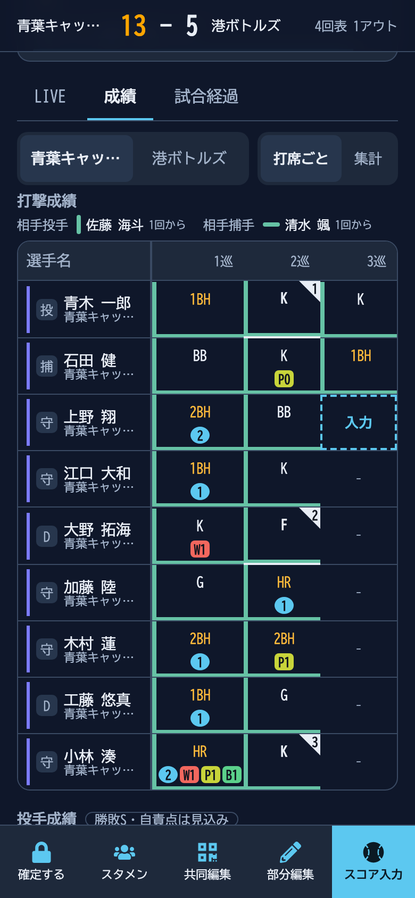
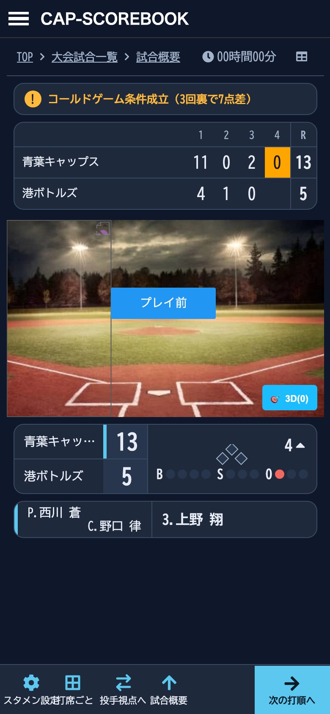
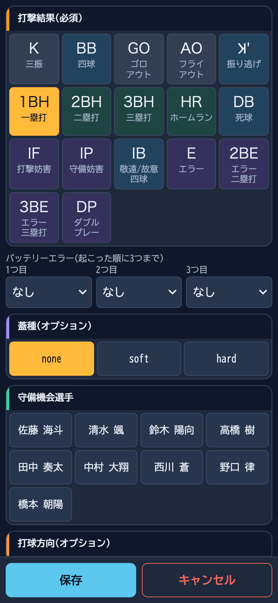

入力モード「1打席ごと」では、1打席につき結果を1回選んで保存します。初めて記録する人は、このモードを使います。1球ずつ記録する「1球簡易」「1球詳細」は、慣れた人向けのモードです。

## 入力画面を開く

- **試合を始めるとき**: スタメン表設定の「最初から開始」をタップします。
- **途中から再開するとき**: 試合詳細の「成績」タブを開き、打席の表で「入力」と表示されているマスをタップします。次に入力する打席の画面が表示されます。
  - 試合中の試合詳細は「LIVE」タブで開きます。「成績」タブに切り替えます。
  - スマートフォンでは、成績の表は1チームずつ表示され、最初は先攻のチームです。「入力」のマスは攻撃中のチームの表にあるので、チーム名のボタンで切り替えます。「打席ごと」と「集計」のボタンは「打席ごと」にします。

記録者メニューの「スコア入力」は、いつも先攻の1番打者の画面を開きます。途中から再開するときは使いません。

*試合中の試合詳細の「成績」タブ（スマートフォン）。点線で囲まれた「入力」のマスが、次に入力する打席*

## 入力モードを確かめる

入力画面の下のメニューに、いまのモード名（「1打席ごと」など）が表示されたボタンがあります。「1打席ごと」になっていなければ、「1打席ごと」と表示されるまでタップします。タップするたびに、1球詳細 → 1球簡易 → 1打席ごと の順に切り替わります。

モードはアカウントごとに保存されます。一度「1打席ごと」にすれば、次の試合でも同じモードで始まります。

*入力画面（スマートフォン）。下のメニューの「1打席ごと」がいまのモード。右下が「次の打順へ」*

## 1打席の手順

1. 画面中央の「プレイ前」をタップします。入力欄が表示されます。
2. 「打撃結果(必須)」から結果を1つ選びます。選んだボタンの色が変わります。
3. その打席の間に暴投・捕逸・ボークがあったときは、「バッテリーエラー」に起こった順で入れます（後の節）。
4. 「保存」をタップします。入力欄が閉じ、「プレイ前」だったボタンが結果の名前（「一塁打」など）に変わります。
5. スコアボードの得点・アウト・走者が、実際の試合と合っているかを確かめます。
6. 右下の「次の打順へ」をタップします。次の打者の画面が表示されます。3アウトになっていれば、相手チームの打者の画面に切り替わります。

*入力欄で「1BH（一塁打）」を選んだところ。選んだボタンは黄色になる*

1打席を記録する流れ（プレイ前 → 一塁打を選ぶ → 保存 → 次の打順へ）:

<video src="/scorebook-manual/videos/at-bat.webm" poster="/scorebook-manual/videos/at-bat-poster.png" controls muted playsinline width="390"></video>

「蓋種」「守備機会選手」「打球方向」は入れなくても保存できます。大会で記録が求められているときだけ入れます。

**結果を選ばずに「保存」をタップしないでください。** 結果が空のまま保存されます。

**打席を飛ばさないでください。** 結果を入れずに「次の打順へ」をタップすると、「結果が未入力ですが先に進みますか？」と表示されます。ここで進むと、空いた打席が残ります。空いた打席は後から直しにくいので、「キャンセル」をタップして結果を入れます。

## 打撃結果の一覧

ボタンは、結果の種類で色が分かれています。選んだボタンは、種類に関わらず黄色になります。

| 略号 | 結果 | 色の種類 | アプリの計算 |
|---|---|---|---|
| K | 三振 | 凡退（灰） | 1アウト |
| GO | ゴロアウト | 凡退（灰） | 1アウト |
| AO | フライアウト | 凡退（灰） | 1アウト |
| 1BH | 一塁打 | ヒット（緑） | 走者が全員1つ進む |
| 2BH | 二塁打 | ヒット（緑） | 走者が全員2つ進む（一塁走者は三塁へ、二塁・三塁走者は生還） |
| 3BH | 三塁打 | ヒット（緑） | 走者が全員生還する |
| HR | ホームラン | ヒット（緑） | 打者と走者が全員生還する |
| BB | 四球 | 出塁（水色） | 押し出しの形で進む |
| DB | 死球 | 出塁（水色） | 押し出しの形で進む |
| IB | 敬遠/故意四球 | 出塁（水色） | 押し出しの形で進む |
| ꓘ' | 振り逃げ | 出塁（水色） | 押し出しの形で進む。満塁でも打点は付かない |
| IF | 打撃妨害 | 特殊（紫） | 押し出しの形で進む |
| IP | 守備妨害 | 特殊（紫） | 1アウト |
| E | エラー | 特殊（紫） | 一塁打と同じ |
| 2BE | エラー二塁打 | 特殊（紫） | 二塁打と同じ |
| 3BE | エラー三塁打 | 特殊（紫） | 三塁打と同じ |
| DP | ダブルプレー | 特殊（紫） | 2アウト。走者は塁に残る |

> エラー二塁打・エラー三塁打・ダブルプレーは一般的なキャップ野球では使用しません。

## 走者・アウト・得点は入力しない

走者の進塁、アウトの数、得点、打点、回の交代は、入力した結果からアプリが計算します。これらを直接入力する欄はありません。

走者の進み方は、上の表のとおりに決まっています。一塁打で一塁走者が三塁まで進む、といった記録はできません。

スコアボードの表示が実際の試合と違うときは、どこかの打席の結果かバッテリーエラーが違っています。その打席を直します（[間違えたときの直し方](../fix/)）。

## バッテリーエラーは起こった順に入れる

「バッテリーエラー(起こった順に3つまで)」には、「1つ目」「2つ目」「3つ目」の3つの欄があります。何も起こらなかった欄は「なし」のままにします。その打席の間に起こった暴投（WP）・捕逸（PB）・ボーク（BK）を、起こった順に入れます。

バッテリーエラーを1つ入れると、走者が全員1つ進みます。三塁走者は生還します。打席の結果より先に計算されます。

順番が大事なのは、**自責点が変わるから**です。捕逸で生還した走者は、投手の自責点になりません。暴投とボークで生還した走者は、自責点になります。

例: 走者二塁で、暴投と捕逸が1つずつあった場合

| 入れた順 | 起きること | 投手の自責点 |
|---|---|---|
| 1つ目 暴投、2つ目 捕逸 | 暴投で三塁へ進み、捕逸で生還 | 0 |
| 1つ目 捕逸、2つ目 暴投 | 捕逸で三塁へ進み、暴投で生還 | 1 |

## コールドゲームの表示

点差がコールドゲームの基準（1回15点差・2回10点差・3回7点差）に達すると、「コールドゲーム条件成立」と表示されます。

表示されるだけで、入力は止まりません。試合が終わったら、入力をやめて[試合を終える](../finish/)の手順に進みます。

## タイブレークの回

タイブレークの回では、大会で決めたアウト数と走者がアプリによって置かれます。記録者が走者を入れる必要はありません。

ただし、**走者とアウトが画面に表示されるのは、その回の先頭打者の結果を保存した後**です。先頭打者を保存する前は、0アウト・走者なしと表示されます。故障ではありません。

タイブレークで最初から置かれた走者が生還しても、投手の失点にも自責点にもなりません。
