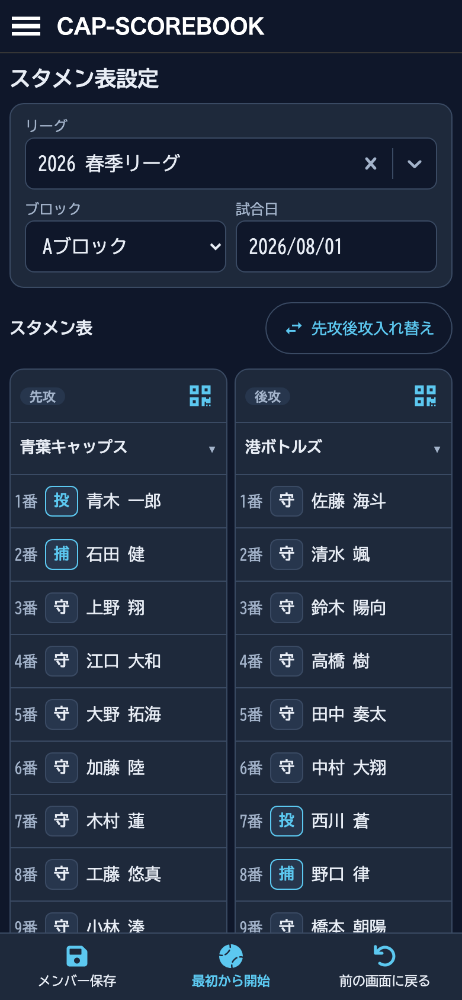

試合の作成とスタメンの設定は、同じ画面「スタメン表設定」で行います。

**試合は、利用者が削除できません。** 同じ試合がすでに作られていないかを、大会の試合一覧で確かめてから作ります。間違えて作った試合の削除は、管理人に依頼します。暫定措置として「非公開」にしてください。

## 試合を作る

1. トップページのメニューから「試合新規作成」を開きます。「スタメン表設定」が表示されます。この時点では、まだ試合は作られていません。
2. 「リーグ」で大会を選びます。
3. 「試合日」を入力します。
4. 左の列で先攻のチーム、右の列で後攻のチームを選びます。**左が先攻、右が後攻**です。
5. 各チームの1番から順に、選手と守備位置を入れます（次の節）。
6. 「メンバー保存」をタップします。「試合が作成・更新されました。」「出場選手が登録・更新されました。」の2つが続けて表示されます。ここで初めて試合が作られます。
7. 「最初から開始」をタップします。1回表・1番打者の入力画面が表示されます。

*スタメン表設定（スマートフォン）。左の列が先攻、右の列が後攻*

先攻と後攻を逆に入れたときは、「先攻後攻入れ替え」で列ごと入れ替えます。打席を入力した後に入れ替えると記録が合わなくなるので、入れ替えは試合を始める前に済ませます。

## スタメンを入れる

- 打順は1番から9番までです。**上から空けずに入れます。** 途中の行を空けると、後で開き直したときに打順がずれます。9人に満たないチームは、下の行を空けます。
- 守備位置は「投手」「捕手」「守備」「DH」から選びます。内野・外野の区別はありません。スマートフォンでは、選んだ守備位置が「投」「捕」「守」「DH」と短く表示されます。
- **各チームに投手と捕手を1人ずつ入れます。** いないと「投手・捕手を先攻・後攻で一人ずつ設定してください。」と表示され、保存できません。
- 選手は、名前かチーム名で検索して選びます。ほかのチームの選手（助っ人）も選べます。
- 同じチームに同じ選手を2回入れると、「同じチームに同じ選手が重複しています。」と表示され、保存できません。
- 新しい試合を開いたとき、最初から選手が入っている行があります。出場する選手に全員入れ替えます。

## MYスタメン表の QR コードで読み込む

チームの人が自分のスマートフォンで打順を作っておくと、記録者は QR コードを読むだけでスタメンを入れられます。

チームの人の操作:

1. メニューの「QRスタメン表」（左メニューでは「MYスタメン表」）を開きます。
2. 1番から順に選手と守備位置を入れます。画面に QR コードが表示されます。
3. 「メンバー保存」をタップします。次に開いたときも同じ内容が表示されます。保存できるスタメン表は、1アカウントに1つです。

記録者の操作:

1. 「スタメン表設定」で、読み込みたい列（先攻か後攻）の QR コードのボタンをタップします。
2. 「QRメンバー表を読み込むと既存のメンバー表は上書きされます。よろしいですか？」と表示されます。「OK」をタップします。
3. ブラウザがカメラの使用を求めたら、許可します。
4. チームの人の画面の QR コードを読み取ります。その列の選手と守備位置が入れ替わります。

QR コードにチーム名は入っていません。チームは別に選びます。

## タイブレークと非公開

- **タイブレーク設定**: タイブレークのある試合は、「タイブレーク設定」で「◯回から」を選んでから「メンバー保存」をタップします。試合の途中で設定しても、その回から反映されます。
- **非公開**: チェックを入れると、試合が試合一覧に表示されなくなり、成績の集計にも入りません。通常はチェックを入れません。

## ほかの人と一緒に記録する（共同編集）

1. 試合詳細の記録者メニューから「共同編集」を開きます。QR コードが表示されます。
2. 一緒に記録する人に、ログインした状態で QR コードを読み取ってもらいます。「◯◯さんに編集許可を発行しました。」と表示されます。

**一度出した許可は取り消せず、QR コードに有効期限もありません。** QR コードの画像や URL は、記録を任せる人以外に渡さないでください。
