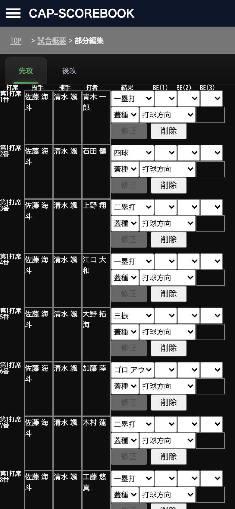

打席を直すと、その後の走者・アウト・得点はアプリが計算し直します。後ろの打席を1つずつ直す必要はありません。

直し方は2つあります。迷ったら「部分編集」を使います。

| 直し方 | 向いている場面 |
|---|---|
| 入力画面で保存し直す | 保存した直後に、いまの打席の間違いに気づいたとき |
| 部分編集 | 前の打席を直すとき。選手交代の入れ忘れを直すとき |

## いまの打席を保存し直す

1. 入力画面で、結果の名前が表示されているボタン（「一塁打」など）をタップします。入力欄が表示されます。
2. **すべての項目を入れ直します。** 前に入れた内容は表示されません。打撃結果だけでなく、バッテリーエラー・蓋種・守備機会選手・打球方向も、入れていたものは入れ直します。
3. 「保存」をタップします。打席の記録が、新しい内容に置き換わります。

**選手交代があった後は、交代より前の打席をこの方法で直さないでください。** 入力画面から保存すると、その打席の投手・捕手・打者が、いまの出場選手に書き換わります。前の打席は「部分編集」で直します。

## 部分編集で直す

1. 試合詳細の記録者メニューから「部分編集」を開きます。記録した打席の一覧が表示されます。
2. 先攻・後攻のタブで、直したいチームを選びます。
3. 直したい打席の行で、投手・捕手・打者・結果・バッテリーエラーなどを選び直します。
4. その行の「修正」をタップします。ページが読み込み直されます。

*部分編集の画面（スマートフォン）。1行が1打席*

**1行直すたびに「修正」をタップします。** 複数の行を変えてから1つの「修正」をタップすると、ほかの行の変更は消えます。

打席そのものを消すときは、その行の「削除」をタップします。「本当に打席結果を削除しますか？」と表示されます。削除した打席は元に戻せません。

部分編集でできないこと:

- 記録していない打席を追加すること
- 打席の順番（打順や何巡目か）を変えること

飛ばしてしまった打席は、その前の打席の入力画面を開き、「次の打順へ」で進んでから入力します。

## 部分編集の後は、最後の打席を保存し直す

部分編集は、試合一覧に表示されるスコアを更新しません。試合一覧のスコアと順位表は、入力画面で打席を保存したときの得点で決まります。

**部分編集で打席を直したら、最後に、試合の最後の打席を入力画面で保存し直します。**

1. 試合詳細の「成績」タブで、試合の最後の打席のマスをタップします。入力画面が表示されます。スマートフォンでは、最後に攻撃したチームの表に切り替え、「打席ごと」の表示にします。
2. 結果の名前が表示されているボタンをタップし、その打席の内容をすべて入れ直します。
3. 「保存」をタップします。試合一覧のスコアが、直した後の得点に更新されます。

試合詳細のスコアボードは、部分編集の直後から正しく表示されます。試合一覧のスコアは、この手順を行うまで古いままです。

## 確定した後に直したとき

試合を確定した後に打席を直しても、打率や防御率などの成績には反映されません。次の順に行います。

1. 打席を直します。
2. 部分編集を使ったときは、最後の打席を入力画面で保存し直します（上の節）。
3. 試合詳細で「ロック解除」をタップします。
4. 「確定する」をタップします。

順番を守ります。勝敗は確定したときの試合のスコアで決まるので、最後の打席の保存し直しを先に済ませます。

成績は、「確定する」をタップした時点の打席から作り直されます。詳しくは[試合を終える](../finish/)にあります。
